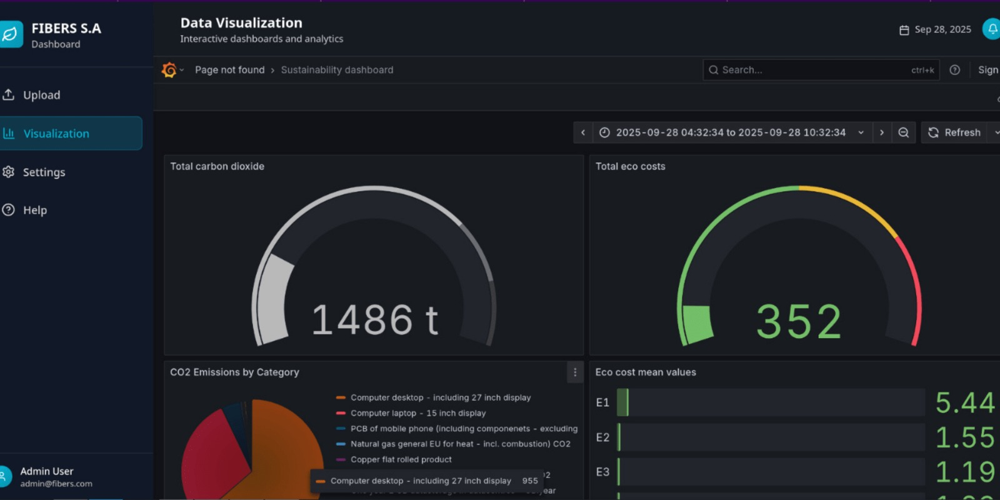
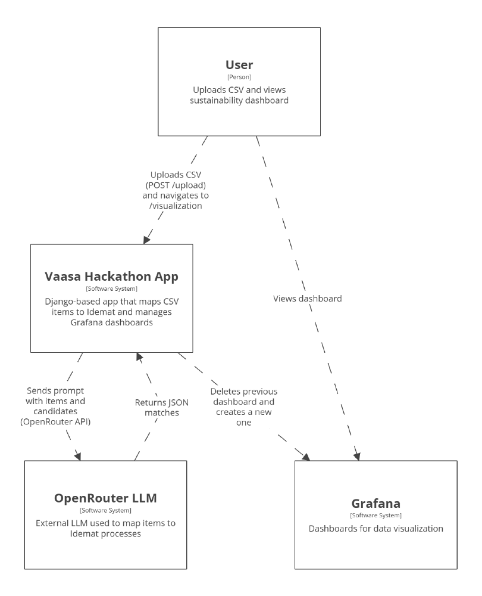

# Sustainability Intelligence Platform (SIP)

Web platform that turns a company's activity data into sustainability metrics
following the ESRS environmental standards (E1 to E5).

> JunctionX Vaasa 2025 · Wärtsilä Challenge · Team Fibers: Bilal Moussaoui El Azrak,
> Xinshen Xiang Chen, Pau López Pujals, Anouar El Haddadi El Yahyati

## About the project

Companies collect a lot of environmental data (energy, fuel, materials) but
struggle to turn it into the reports the EU sustainability standards (ESRS)
require. SIP takes a CSV of a company's activities and calculates its CO₂ and
eco costs automatically, split into the five ESRS environmental categories:
climate change (E1), pollution (E2), water (E3), biodiversity (E4) and
resource use (E5).

## Demo

Walkthrough of the platform: uploading a CSV and exploring the results.

[](https://www.youtube.com/watch?v=pj1axi1YByM)

## What it does

1. The user uploads a CSV with the company's activities.
2. Each activity is matched to the closest process in the Idemat 2025 database.
   A fuzzy search shortlists candidates and an LLM picks the best match.
3. The platform calculates CO₂ and eco costs per activity, split into E1 to E5.
4. Results are stored in PostgreSQL and shown in a Grafana dashboard.



## Architecture



## Tech stack

* **Backend:** Python, Django
* **Database:** PostgreSQL
* **Data and AI:** Pandas, difflib, Mistral 7B (OpenRouter)
* **Dashboards:** Grafana
* **Frontend:** Django templates, Tailwind CSS, JavaScript
* **Standards:** ESRS E1 to E5, Idemat 2025 eco costs

## Example input

```csv
activity,quantity,unit
Electricity consumption,2000,kWh
Diesel used in transport,150,L
Plastic packaging,50,kg
```
